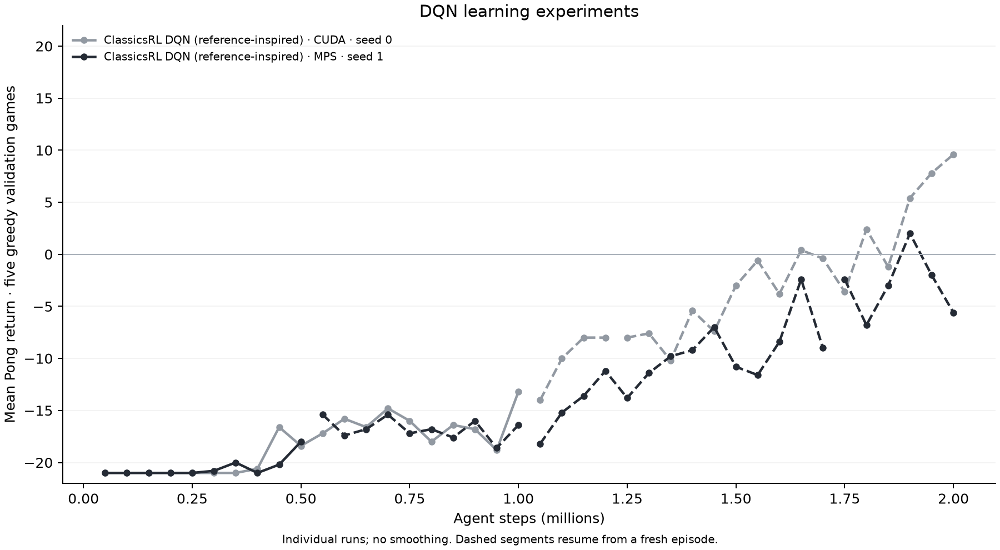
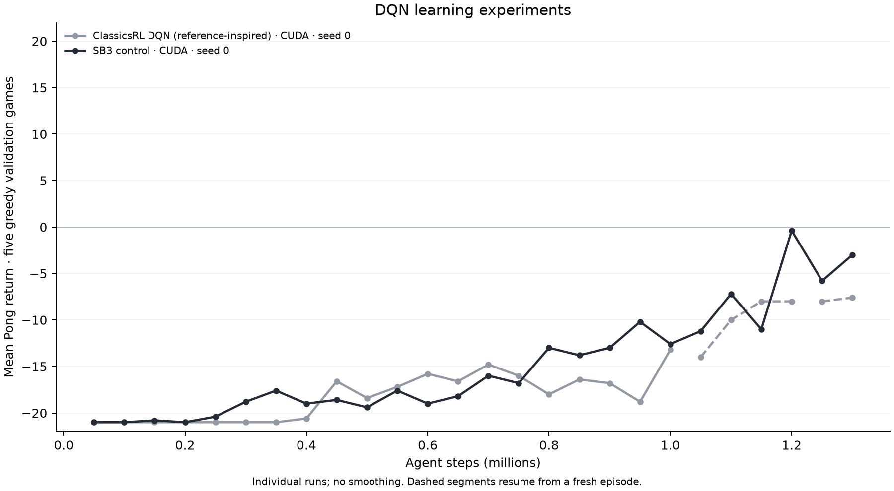
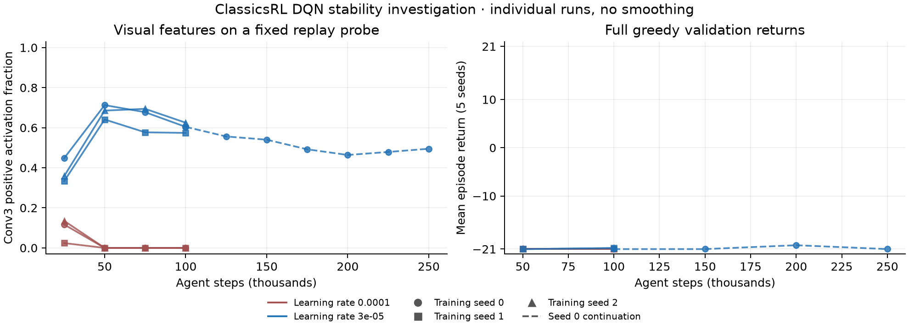

# Experiments

These are development results, not a claim of algorithmic novelty. The committed
reports retain raw returns, learning settings, source-file hashes, dependency
versions, and recovery boundaries. Exact machine details, absolute storage paths,
and original Git revision links are withheld. Unredacted originals remain private.
Models, replay, and recordings stay outside the repository.

## Two-million-step Pong runs

Both ClassicsRL runs used `configs/pong-reference-inspired.toml`, completed
2,000,000 agent steps and 480,001 updates, and selected the highest greedy
validation mean, preferring the latest checkpoint on ties. Validation used five
full games, seeds 1,000,000–1,000,004. Selection was locked before the final tests
on seeds 5,000,000–5,000,049. All final games ended naturally.

| Training seed / device | Selected step | Validation mean | Test mean | Wins / 50 |
| --- | ---: | ---: | ---: | ---: |
| 0 / CUDA | 2,000,000 | +9.6 | +8.88 | 46 |
| 1 / MPS | 1,900,000 | +2.0 | +0.42 | 22 |
| Random actions | — | — | -20.28 | 0 |

The CUDA policy is a working winning agent. The MPS seed did not reproduce its
strength. Seed, backend, and recovery history differ, so the gap cannot be
attributed to hardware. The proposed target—mean return above +10 and at least
80% wins per seed, confirmed in three training seeds—is unmet.

CUDA recovered at 1M and 1.2M steps; MPS also recovered from a verified 1.7M
snapshot after an execution interruption. Recovery starts a fresh emulator
episode. Each segment's actual settings and source are retained in the reports:

- [CUDA seed 0](experiments/dqn-long-cuda.json)
- [MPS seed 1](experiments/dqn-long-mps.json)



These are five-game validation means, not the final test means. Dashed segments
follow recovery. Separate demonstrations do not contribute to the test results.

Post-run inspection found no all-zero Conv3 collapse on either run's saved replay
probe: the minimum active fractions across stored policies were 0.082 and 0.092.
The probes differ between runs, so their activation magnitudes are not a controlled
backend comparison. The MPS validation score fell from -2.4 at 1.65M to -9.0 at
1.7M before that recovery, and later from +2.0 at 1.9M to -5.6 at 2M without another
recovery. These observations do not isolate a cause; seed-matched trials with
controlled recovery are needed before attributing the gap to the backend or a
specific hyperparameter.

## Common-budget SB3 control

The optional reference runner uses Stable-Baselines3 2.9.2's native collector,
replay, and updates with matched wrappers, architecture, initial weights, optimizer
settings, and exploration schedule. Remaining differences include warm-up RNG,
reset behavior, and target synchronization before a boundary update rather than
after it. The evaluator and wrappers are shared, so this is not an independent
validation of the environment.

The reference runtime ended with policies and validations persisted through 1.3M
steps. The runner used then saved playback policies, not replay/optimizer state;
the original 2M control could not be completed from those files. A post-hoc common
budget of 1.3M was chosen before new tests. Both selections were locked using only
validation within that prefix, then tested on seeds 7,000,000–7,000,049.

| Policy | Selected step | Test mean | Wins / 50 | Truncations |
| --- | ---: | ---: | ---: | ---: |
| ClassicsRL | 1,300,000 | -5.50 | 6 | 0 |
| SB3 | 1,200,000 | -1.94 | 22 | 0 |
| Random | — | -20.50 | 0 | 0 |

SB3 performed better in this trial. The later 2M ClassicsRL winner is a separate
result; one training seed and different recovery histories do not establish
implementation superiority. No SB3 training was restarted for this analysis.

- [Selections and raw tests](experiments/dqn-prefix-comparison-1300k.json)
- [All 26 validation evaluations per source](experiments/dqn-prefix-validation-1300k.json)



## Correctness and early stability

The [SB3 arithmetic audit](experiments/dqn-reference-audit.json) matched 20
fixed-batch updates exactly for Q-values, loss, gradients, weights, and Adam state.
It used fresh Adam states, real replay images, explicit termination/truncation
masks, and manually synchronized targets. This checks update arithmetic, not full
training trajectories or general playing strength.

An earlier controlled study found all-zero Conv3 features on a fixed replay probe
at learning rate 1e-4. Changing only the rate to 3e-5 preserved features in three
100k-step seeds:

| Seed | Conv3 active fraction, 1e-4 | Conv3 active fraction, 3e-5 | Validation mean, 3e-5 |
| --- | ---: | ---: | ---: |
| 0 | 0 | 0.604 | -21.0 |
| 1 | 0 | 0.574 | -20.8 |
| 2 | 0 | 0.625 | -20.8 |

A 250k continuation retained active features but scored -21 on five held-out
games, versus -20.6 for random actions. Feature activity does not establish useful
play. The lower rate remains a starting mitigation, not a general recommendation.
The [stability report](experiments/dqn-stability.json) includes the raw data,
shared replay-probe identity, source versions, and CPU/MPS diagnostic comparisons.



## Reproduction

Start each trial in a new run directory. Declare training seeds, budget, selection
rule, and test seeds before running the experiment. The test seeds above have
already been inspected; reserve new seeds for future final tests.

```sh
uv run --extra atari classicsrl train --config configs/pong-reference-inspired.toml \
  --seed 0 --steps 2000000 --device cuda --run runs/pong-seed-0
uv run --extra atari python scripts/evaluate_run.py runs/pong-seed-0 \
  --device cuda --episodes 50 --seed 9000000 --label new-test
```

`evaluate_run.py` requires the declared budget to finish and locks the selection
before testing. `compare_prefix.py` locks selections within a stated common
budget without marking interrupted source runs complete. Existing selections
must not be overwritten after scores are inspected.

The optional reference command is:

```sh
uv run --extra atari --with stable-baselines3==2.9.2 \
  python scripts/train_sb3_reference.py --config configs/pong-reference-inspired.toml \
  --run runs/sb3-seed-0 --seed 0 --steps 2000000 --device cuda
```

The current runner also saves verified native SB3 recovery snapshots under
`reference-snapshots/`. They include both networks, Adam state, replay, counters,
and Python/NumPy/Torch/action-space RNG states. Snapshots are taken after a complete
rollout and update; an interruption during an update falls back to the previous
snapshot. They cannot recover the original control's missing state.

To resume, copy the complete persisted run to runtime-local storage, then use:

```sh
uv run --extra atari --with stable-baselines3==2.9.2 \
  python scripts/train_sb3_reference.py \
  --resume runs/sb3-seed-0/reference-snapshots/<snapshot> --device cuda
```

The original training budget and learning settings stay fixed on resume so the
exploration schedule does not change. Recovery starts a fresh emulator episode;
it does not reproduce an uninterrupted trajectory. Load only trusted snapshots:
SB3 model and replay loading uses pickle. `--persist-dir` copies verified snapshots
to a dedicated run-ID directory, excluding unfinished temporary copies. Replay is
gzip-compressed, but SB3's stacked replay still needs substantial RAM and storage;
measure snapshot/copy time before starting a long session. Snapshot, evaluation,
and persistence time is excluded from reported training time.

Use `classicsrl diagnose --help` for fixed-replay feature and device checks, and
`scripts/collect_stability.py --public` to collect shareable reports from complete
local runs against a shared probe.
`scripts/compare_dqn_reference.py` reproduces the fixed-batch arithmetic audit.

Plots need only committed numeric reports and optional Matplotlib:

```sh
uv run --no-project --with matplotlib python scripts/plot_learning.py \
  docs/experiments/dqn-long-cuda.json docs/experiments/dqn-long-mps.json \
  --output docs/figures/dqn-long-seeds.png
uv run --no-project --with matplotlib python scripts/plot_stability.py \
  docs/experiments/dqn-stability.json --output docs/figures/dqn-stability.png
```

For local throughput checks, use `configs/benchmark.toml` in separate CPU/MPS/CUDA
runs and measure after learning starts. Warm-up collection is not learning
throughput; short checks do not predict sustained speed or time to useful play.
Exact training trajectories across versions and devices are not promised.

Unredacted development records are kept privately. Shared reports omit machine
identifiers; their numerical results are unchanged.
